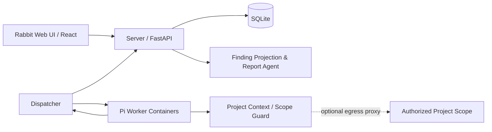

# Rabbit (Cairn-Y)


Rabbit is a multi-agent platform for authorized security assessments. It extends the fact-graph idea from [oritera/Cairn](https://github.com/oritera/Cairn) and turns automated exploration into a closed loop that can be verified, traced, and delivered: **the Server holds the only state, the Dispatcher schedules work, Pi Workers run Decide / Execute, results are written back as Facts, and a confirmed issue exists only as a Finding.**

The project directory and Python CLI keep the `cairn` name so the original layout still works. The product interface is Rabbit.

> Rabbit is only for security testing, internal validation, and research environments where you already have explicit authorization. Read the [disclaimer](#disclaimer) before use. Scope constraints are in [AUTHORIZED_SECURITY_SCOPE.md](AUTHORIZED_SECURITY_SCOPE.md).

## Product preview

### Dashboard


### Fact-graph workspace


### Vulnerability reports


<details>
<summary>Sign-in page</summary>


</details>

## Cairn-Y core model

```text
Origin
  └─ Goal
      └─ Decide (serial decisions; only creates or adjusts Steps)
          └─ Step
              └─ Execute (parallel)
                  ├─ Fact
                  └─ Finding (optional; must reference a Fact)
```

- **Server**: the only state of record. It stores Project, Goal, Step, Fact, and Finding.
- **Dispatcher**: project lifecycle, serial Decide, parallel Execute, worker scheduling, leases, heartbeats, and timeouts.
- **Pi Worker**: the only execution unit. The current runtime registers Pi and does not keep a second execution kernel.
- **Fact**: an objective result confirmed during Execute. Success, failure, and "nothing found" all end as a Fact.
- **Finding**: a structured discovery emitted by Execute. It is the only source the report system may use.
- **Vulnerability**: a projection of a Finding for the UI and export formats. It is not a second vulnerability store.
- **Report agent**: rewrites existing Findings and their evidence. It does not guess vulnerabilities from Facts, add vulnerabilities, or change severity.

## Architecture



The runtime has three task types:

1. `decide`: read the current FGS state and create the next Steps. One project is always serial.
2. `execute`: run one Step and emit a Fact description plus an optional Finding. Steps may run in parallel.
3. `execute_conclude`: atomically write the result back to the Server, close the Step, and record provenance.

## v1.0 execution layer

v1.0 aligns the execution core with Cairn-Y and stops long experiments from being cut off or restarted from zero after a failure:

| Capability | What it does |
|---|---|
| **Bounded step prompts** | Decide, execute, and conclude prompts carry the same limits: one verifiable question per step, stop when it is confirmed, do not exhaust a lead for its own sake, and do not start work whose prerequisite is still unconfirmed. |
| **step_recovery** | After a timeout or parse failure the step enters `summary_pending` or `commit_pending`. A retry does **not** repeat the original action. It only completes the summary or replays the commit. If recovery fails, the step becomes `needs_attention` and is not auto-rerun. |
| **Strict output parsing** | Fail-closed JSON parsing rejects duplicate keys, fences, and trailing junk. A failed parse gets one targeted repair retry with a syntax diagnosis. Only a failed repair fails the step. |
| **Tool timeouts** | A single Pi bash call defaults to 90 seconds (`CAIRN_BASH_TIMEOUT_SECONDS`) so one command cannot consume the whole step budget. |
| **JDK toolchain** | The worker image includes a JDK. `jdb` and `javap` are available, so JDWP targets do not need a hand-written protocol client. |
| **600 second step budget** | Each step has 600s (540s of exploration plus a 60s reserve) and a separate 90s conclude budget, so a long verification chain can finish in one step. |

Operator hints are injected into the worker context at each new phase. A hint may be evidence, a suggestion, a correction, or an explicit constraint. The agent interprets the content. It does not override a higher-priority instruction.

## Current capabilities

- **One workspace**: dashboard, projects, vulnerability reports, workers, templates, audit log, and settings.
- **Fact-graph exploration**: Goal / Step / Fact / Finding as a visual graph, with provenance, a timeline, and execution logs.
- **Single-loop agents**: Decide is serial, Execute is parallel, and conclude writes back atomically. There is no second state store.
- **Execution reliability**: bounded prompts, session recovery, strict parse-and-repair, and tool timeouts.
- **Isolated workers**: containerized Pi workers, concurrency limits, leases, heartbeats, timeouts, startup health checks, and failover.
- **Scope and egress**: project context and the scope guard bound the target. An egress proxy can enforce the network boundary when you need it.
- **Finding-driven reports**: the vulnerability view projects only Findings that reference a real Fact. It does not guess from ordinary execution logs.
- **Delivery**: filters, status, evidence screenshots, the report agent, export history, and Markdown / PDF / DOCX export.
- **Client templates**: import and enable a DOCX template, then fill it with structured findings and evidence images.
- **Operations and audit**: global stats, risk trend, notifications, action audit, retention, and health checks.
- **Identity**: registration switch, arithmetic captcha, failure lockout, bcrypt password hashes, and server-side sessions.

## Quick start

First install, upgrade, backup, and troubleshooting are in [Install and upgrade](INSTALL.md).

You need Docker Engine or Docker Desktop, Compose v2, and an OpenAI-compatible model API.

```bash
git clone https://github.com/Rabbit0007/Rabbit.git
cd Rabbit
git checkout v1.0
cp .env.example .env
cp dispatch.yaml dispatch.local.yaml
```

Put three service tokens in `.env`:

```dotenv
CAIRN_INTERNAL_TOKEN=replace-with-random-value
CAIRN_DISPATCHER_INTERNAL_TOKEN=replace-with-another-random-value
CAIRN_WORKER_EGRESS_PROXY_TOKEN=replace-with-another-random-value
```

Put the model key in `PI_API_KEY` inside `dispatch.local.yaml` and keep that file on this machine. The template registers 4 GLM-5.3 Pi workers:

```text
Model: glm-5.3
Base URL: https://open.bigmodel.cn/api/coding/paas/v4
Provider API: openai-completions
```

To use another model, change only the local `dispatch.local.yaml`. Git ignores that file. Do not put a real key in the public `dispatch.yaml` template. Adjust `TSEC_SERVER_HOST` in the local file if it does not match this machine's container network.

Build the worker image (v1.0 includes a JDK, so `jdb` and `javap` are present) and start:

```bash
docker build --platform linux/amd64 -f container/Dockerfile.pi -t rabbit-pentest-worker:pi-0.84.4-jdk .
docker compose up -d --build
docker compose ps
```

Open `http://127.0.0.1:8000/` and register an account on the sign-in page. Stop the stack with:

```bash
docker compose down
```

The database lives in `./datas/cairn/`. Report evidence lives in the Docker volume `rabbit-pentest-artifacts`. The service binds `127.0.0.1:8000` by default. The frontend is built during the Docker build. You do not need to run npm first.

> After editing `dispatch.local.yaml`, run `docker compose up -d --force-recreate pentest-dispatcher`. It is a single-file bind mount, so a plain `restart` does not reload it.

## Default worker concurrency

The repository template registers 4 Pi workers on the same model. The dispatch cap is 4:

```text
glm-5.3-1 ... glm-5.3-4
```

Default scheduling limits:

```yaml
runtime:
  max_workers: 4
  max_running_projects: 1
  max_project_workers: 4

tasks:
  decide:
    max_steps: 3
  execute:
    timeout: 600                # per-step budget (v1.0)
    conclude_timeout: 90
    conclude_reserve_seconds: 60
```

One project runs at a time and may use up to 4 dispatch slots. Decide stays serial, so two decision loops never edit the FGS at once.

## Report generation

There is one report path:

```text
Decide creates a Step
→ Pi Execute returns a description and an optional finding
→ conclude atomically creates a Fact and closes the Step
→ a valid Finding is stored against that Fact
→ the Finding is projected into the vulnerability view
→ the report agent organizes existing Findings
→ the UI shows or exports them
```

A Finding enters the vulnerability report only when:

- `kind` is `security_vulnerability` or `vulnerability`
- `severity` is `critical`, `high`, `medium`, or `low`
- it references a real `fact_id`

An execution result that has a Fact and no Finding does not enter the vulnerability report.

Reports use recorded Findings and linked evidence. They do not infer vulnerabilities from ordinary execution logs.

## Development and tests

Backend tests:

```bash
cd cairn
uv sync
uv run --with pytest --with httpx python -m pytest
```

Frontend build:

```bash
cd cairn/frontend
npm install
npm run build
```

Server only:

```bash
cd cairn
uv run cairn serve --host 127.0.0.1 --port 8765 --log-level info
```

Useful checks:

```bash
docker compose ps
curl -sS -o /dev/null -w '%{http_code}\n' http://127.0.0.1:8000/
```

## Layout

```text
.
├── cairn/
│   ├── frontend/                         # Web UI
│   ├── src/cairn/dispatcher/             # Scheduling, tasks, and the Pi worker adapter
│   ├── src/cairn/server/                 # API, auth, state, Findings, and reports
│   └── tests/                            # Backend and Cairn-Y core tests
├── container/                            # Worker image (Dockerfile.pi includes a JDK)
├── docs/specs/                           # Protocol and dispatcher design
├── .rabbit/context/                      # Reusable project-context templates
├── dispatch.yaml                         # Default Pi worker config (placeholder template)
├── docker-compose.yaml                   # Full runtime
└── .env.example                          # Environment template
```

## Design and verification docs

- [Changelog](CHANGELOG.md)
- [Cairn-Y implementation summary](cairn/CAIRN_Y_SUMMARY.md)
- [Test report](cairn/TEST_REPORT.md)
- [Server protocol](docs/specs/server-protocol.md)
- [Dispatcher design](docs/specs/dispatcher-design.md)

## Disclaimer

**This project is only for explicitly authorized security testing, validation of assets you own, teaching, research, and lab environments.**

1. **Authorization first.** Before testing any target, you must have written authorization from the asset owner or their legal delegate. Penetration testing, vulnerability probing, or exploitation of a computer system without authorization is illegal in most jurisdictions.
2. **You own compliance.** You are responsible for knowing and following the law where you operate. Any direct or indirect legal liability from using or misusing this tool is yours, not the authors' or contributors'.
3. **Output is not guaranteed correct.** Findings, conclusions, and reports are produced by large-language-model agents. They can be false positives, false negatives, stale, or inaccurate. Do not treat a Finding as a fact or a delivery conclusion until a person has reviewed and verified it.
4. **No warranty.** The project is provided AS IS, without warranty of any kind, including merchantability, fitness for a particular purpose, and non-infringement. See sections 15 and 16 of the [AGPL-3.0 LICENSE](LICENSE).
5. **Prohibited use.** Do not use this tool for destructive operations, denial of service, persistent control of unauthorized assets, lateral movement outside the authorized scope, supply-chain attacks, or any other action that harms someone else's systems or data.
6. **Use means you accept this.** Downloading, copying, or using this tool means you have read, understood, and agreed to this disclaimer. If you do not agree, stop and delete it.

## Acknowledgements

Rabbit / Cairn-Y continues the fact-graph collaboration model from [oritera/Cairn](https://github.com/oritera/Cairn). Thanks to the original project for the open work on fact graphs, agent collaboration, and automated exploration.

## License

This project is licensed under the [AGPL-3.0 License](LICENSE) in the repository.
